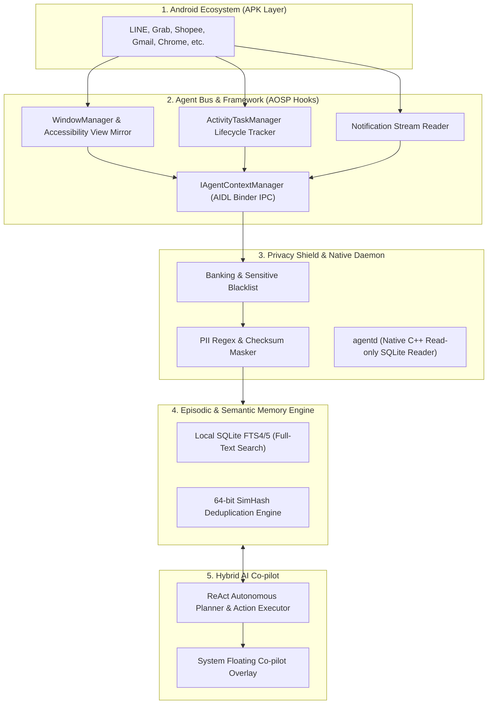

# 🌐 Agentic Mobile OS (AOS)

> **The Open-Source, Context-Aware Operating System Layer for Autonomous Mobile AI.**
> Built on Android (AOSP / LineageOS) to transform AI into a system-level co-pilot that understands cross-app context while seamlessly running any standard Android app (APK).

[](LICENSE)
[](https://source.android.com/)
[](https://kotlinlang.org/)
[](#-roadmap)

---

## 💡 The Core Vision (ทำไมต้อง Agentic OS?)

ผู้ช่วย AI บนสมาร์ตโฟนในปัจจุบัน (เช่น Siri หรือ Google Assistant) ติดอยู่ใน **Application Sandbox** ทำให้ไม่สามารถเข้าใจบริบทการทำงานจริงของผู้ใช้ และไม่สามารถทำงานต่อเนื่องข้ามหลายแอปได้ ในขณะเดียวกัน อุปกรณ์ AI ฮาร์ดแวร์เฉพาะทางยุคแรก (เช่น Rabbit R1, Humane AI Pin) ล้มเหลวเพราะบังคับให้ผู้ใช้ทิ้ง Ecosystem ของแอปเดิม

**AOS (Agentic OS)** แก้ปัญหานี้โดย:
1. **Zero Switching Cost:** รองรับการติดตั้งและรันไฟล์ APK เดิมทั้งหมด 100%
2. **Compact Semantic DOM (ระดับ OS Framework):** ดึงโครงสร้างหน้าจอระดับ View Hierarchy แทนการแคปหน้าจอ ประหยัด Token ลง 10–50 เท่า และแม่นยำสูง
3. **Local-First Episodic Memory:** บันทึกประวัติและบริบทการใช้งานข้ามแอปด้วย SQLite FTS4/5 + Vector Index ในเครื่อง พร้อมระบบ SimHash ป้องกันการบันทึกหน้าจอซ้ำซ้อน (> 85% match)
4. **4-Stage Privacy Shield:** บล็อกแอปธนาคาร รหัสผ่าน และตัดข้อมูลส่วนบุคคล (PII: บัตรประชาชนไทย, บัตรเครดิต, OTP) ออกอัตโนมัติก่อนส่งต่อไปยังโมเดล AI

---

## 🏛️ System Architecture



---

## 📁 Repository Structure

```text
AOS/
├── planning/                          # เอกสารแผนการพัฒนาเชิงลึก (18 เดือน)
│   ├── 00-MASTER-PLAN.md              # ภาพรวมวิสัยทัศน์, โครงสร้างโปรเจกต์ และ Timeline
│   ├── 01-TECHNICAL-ARCHITECTURE.md   # สถาปัตยกรรมระดับ AOSP Hooks, AIDL และ Memory Schema
│   ├── 02-PHASE-1-POC-USERSPACE.md    # แผนพัฒนา Phase 1 (User-Space Prototype)
│   ├── 03-PHASE-2-CUSTOM-AOSP.md      # แผนพัฒนา Phase 2 (LineageOS Fork & agentd C++ Daemon)
│   ├── 04-SECURITY-PRIVACY-COMPATIBILITY.md # แผนจัดการ PII, แอปธนาคาร, microG และแบตเตอรี่
│   ├── 05-ROADMAP-COMMUNITY-FUNDRAISING.md  # กลยุทธ์ Open-Source, SDK, ขอทุน และระดมทุน VC
│   └── 06-TASK-TRACKER.md             # ตารางเช็คลิสต์ติดตามความคืบหน้า (Sprint Backlog)
│
├── poc-userspace/                     # [Phase 1] แอปพลิเคชัน Android ต้นแบบ
│   ├── app/                           # Main UI (Jetpack Compose), Floating Overlay Service
│   ├── collector/                     # Accessibility Mirror, Notification Listener, Shizuku Bridge
│   ├── privacy-shield/                # Banking Blacklist, PII Regex Masker, Action Guardrails
│   ├── memory-engine/                 # SQLite Room DB, FTS4/5, SimHash Deduplicator
│   └── agent-core/                    # Action Executor, ReAct Orchestrator, Prompt Templates
│
└── aosp-patches/                      # [Phase 2] Patches สำหรับฝังลงใน AOSP / LineageOS (กำลังพัฒนา)
```

---

## 🗺️ Roadmap ภาพรวม

| ระยะ | เป้าหมายหลัก | สถานะ |
| :--- | :--- | :--- |
| **Phase 1: User-Space PoC** | ทดสอบระบบ Context Collector + Episodic Memory + Floating UI บนมือถือทั่วไปผ่าน Shizuku & Accessibility | 🟡 กำลังดำเนินการ |
| **Phase 2: Custom AOSP** | Fork LineageOS 22 (Android 15), เขียน `agentd` C++ daemon, ผสาน microG, รันบน Pixel / Cuttlefish | ⚪ รอเริ่ม (เดือนที่ 4) |
| **Phase 3: Open-Source & SDK** | ปล่อย AgentOS SDK ให้นักพัฒนาภายนอก, ปล่อยรอม GSI สู่สาธารณะ | ⚪ วางแผนแล้ว (เดือนที่ 10) |
| **Phase 4: Scale & Fundraising** | ยื่นขอทุนสนับสนุน (NLnet, Mozilla), ระดมทุน Pre-Seed / Seed Round | ⚪ วางแผนแล้ว (เดือนที่ 14) |

---

## 🛠️ การบิลด์และการทดสอบ (Phase 1 PoC)

### ความต้องการของระบบ:
* JDK 17 (Eclipse Adoptium Temurin แนะนำ)
* Android SDK (API Level 35)
* Shizuku (สำหรับทดสอบคำสั่ง Shell สิทธิ์สูง)

### คำสั่งบิลด์:
```bash
cd poc-userspace
./gradlew assembleDebug
```

---

## 📄 License
This project is licensed under the Apache License 2.0 - see the [LICENSE](LICENSE) file for details.
