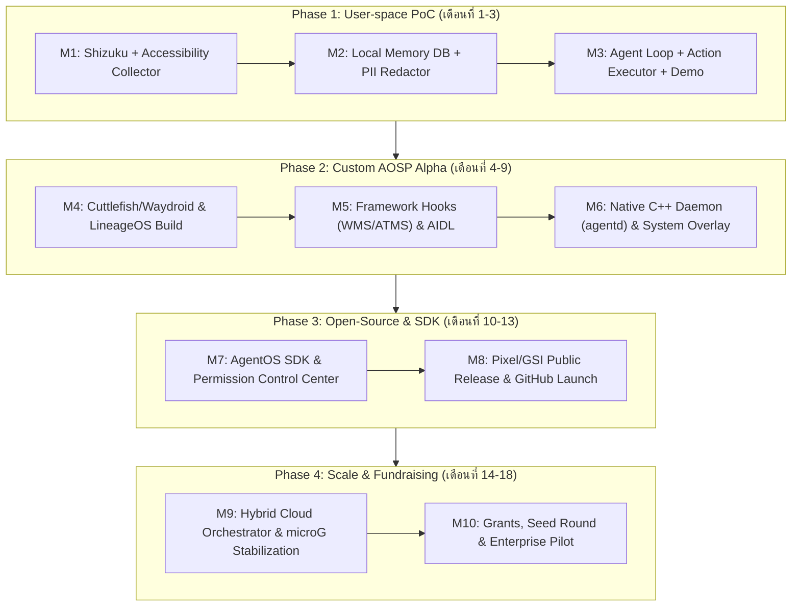

# 🧭 Master Plan: Agentic Mobile OS

> **วิสัยทัศน์ (Vision):** สร้างระบบปฏิบัติการมือถือยุคใหม่บนฐาน Android (AOSP/LineageOS) ที่เปลี่ยน AI จาก "แอปแชทที่ถูกขังใน Sandbox" ให้กลายเป็น **System-level Co-pilot & Autonomous Agent** ที่เข้าใจบริบทข้ามแอปพลิเคชัน (Cross-App Context Awareness) และสามารถลงมือทำงานแทนผู้ใช้ได้จริง โดยยังรันแอป Android (APK) เดิมได้ 100%

---

## 📂 โครงสร้างโฟลเดอร์แผนการ (Planning Directory Structure)

เนื่องจากโปรเจกต์นี้เป็นโปรเจกต์ระยะยาว (Multi-year / Multi-phase Engineering Project) เอกสารแผนงานทั้งหมดจึงถูกแยกตามหมวดหมู่เพื่อให้ค้นหา อัปเดต และใช้เป็น Reference ในการพัฒนาได้อย่างเป็นระบบ:

| ไฟล์เอกสาร | รายละเอียดเนื้อหา |
| :--- | :--- |
| [`00-MASTER-PLAN.md`](./00-MASTER-PLAN.md) | ภาพรวมโครงการ, วิสัยทัศน์, Killer Use Cases, โครงสร้าง Repository และสรุป Timeline ทั้งหมด |
| [`01-TECHNICAL-ARCHITECTURE.md`](./01-TECHNICAL-ARCHITECTURE.md) | สถาปัตยกรรมเชิงลึก: AOSP Framework Hooks, Native C++ Daemon (`agentd`), AIDL Interface, Memory Schema และ Hybrid AI Pipeline |
| [`02-PHASE-1-POC-USERSPACE.md`](./02-PHASE-1-POC-USERSPACE.md) | แผนปฏิบัติการระยะที่ 1 (เดือนที่ 1–3): สร้าง User-space Prototype ด้วย Accessibility + Shizuku + Local/Cloud Agent แบบไม่ต้องคอมไพล์ OS |
| [`03-PHASE-2-CUSTOM-AOSP.md`](./03-PHASE-2-CUSTOM-AOSP.md) | แผนปฏิบัติการระยะที่ 2 (เดือนที่ 4–9): การ Fork AOSP/LineageOS, รันบน Cuttlefish/Waydroid, แก้ไข System Server และเขียน SELinux Policy |
| [`04-SECURITY-PRIVACY-COMPATIBILITY.md`](./04-SECURITY-PRIVACY-COMPATIBILITY.md) | แผนจัดการความปลอดภัย ข้อมูลส่วนบุคคล (PII Masking), การจัดการ Play Integrity / microG และการประหยัดแบตเตอรี่ |
| [`05-ROADMAP-COMMUNITY-FUNDRAISING.md`](./05-ROADMAP-COMMUNITY-FUNDRAISING.md) | แผนระยะที่ 3–4 (เดือนที่ 10–18): กลยุทธ์ Open-Source, การสร้าง Agent SDK, การขอทุน (Grants), โมเดลธุรกิจ และการระดมทุน (VC/Crowdfunding) |
| [`06-TASK-TRACKER.md`](./06-TASK-TRACKER.md) | ตารางติดตามงาน (Actionable Backlog & Milestone Checklist) แบ่งตาม Sprint เพื่อใช้เช็คความคืบหน้ารายสัปดาห์ |

---

## 🎯 ทำไมต้องทำโปรเจกต์นี้? (Problem & Core Value Proposition)

### ปัญหาของมือถือและ AI ในปัจจุบัน:
1. **App Silo & Sandbox Trap:** ข้อมูลของผู้ใช้กระจัดกระจายอยู่ในแอปแชท (LINE, WhatsApp), อีเมล, โน้ต, แอปธนาคาร, แอปช้อปปิ้ง โดยแต่ละแอปไม่คุยกัน
2. **Surface-level AI Assistants:** ผู้ช่วยอัจฉริยะเดิม (Siri, Google Assistant) ทำได้เพียงตั้งปลุกหรือเรียก API เฉพาะที่แอปเปิดให้ (Intents) แต่ไม่สามารถ "อ่านบริบท" หรือ "กดทำงานซับซ้อนข้ามแอป" ได้
3. **ความล้มเหลวของ Dedicated AI Hardware ยุคแรก:** อุปกรณ์อย่าง Humane AI Pin หรือ Rabbit R1 พยายามสร้าง OS ปิดหรือพึ่งพา Cloud Web Automation ทำให้ขาด Ecosystem ของแอปที่ผู้ใช้คุ้นเคย

### จุดแข็งของ Agentic Mobile OS ของเรา:
* **Zero Ecosystem Switching Cost:** รัน APK เดิมได้ทั้งหมด ผู้ใช้ไม่ต้องเลิกใช้แอปที่ตัวเองชอบ
* **Structured Context (ไม่ใช่แค่ Screenshot):** ดึงข้อมูลระดับ View Hierarchy (DOM) และ Database Index จากระดับ OS Framework ทำให้ประหยัด Token กว่าการใช้ Vision Model แคปหน้าจอ 10–50 เท่า และแม่นยำกว่ามาก
* **Episodic & Semantic Memory:** มีระบบจำบริบทการใช้งานตามลำดับเวลา (Timeline Memory) ค้นหาย้อนหลังได้ว่า *"เมื่อ 3 วันก่อนคุยกับใครเรื่องใบเสนอราคา แล้วไฟล์อยู่ที่ไหน"*
* **Privacy-First Hybrid Architecture:** มี On-Device SLM และ Sensitive Filter คอยคัดกรองข้อมูลรหัสผ่าน การเงิน และ PII ในระดับ OS ก่อนส่งต่อให้โมเดลขนาดใหญ่

---

## 🔥 3 Killer Use Cases แรกที่ใช้พิสูจน์คุณค่า (North Star Scenarios)

ในการพัฒนา Phase 1 และ Phase 2 เราจะวัดผลความสำเร็จจาก 3 สถานการณ์หลักนี้:

1. **Cross-App Memory Recall (ความจำข้ามแอปอัจฉริยะ):**
   * *สถานการณ์:* ผู้ใช้ดูคอนโดในแอป Facebook/เว็บเบราว์เซอร์ คุยรายละเอียดใน LINE กับนายหน้า และเซฟรูปห้องไว้ใน Gallery เมื่อ 5 วันที่แล้ว
   * *คำสั่ง:* *"ช่วยสรุปคอนโด 2 ห้องที่คุยกับนายหน้าเมื่ออาทิตย์ก่อน พร้อมเทียบราคาและดึงรูปห้องมาให้ดูหน่อย"*
   * *การทำงาน:* OS ค้นหา Episodic Memory จาก UI Tree + Notification + File Index แล้วรวบรวมคำตอบให้ทันทีโดยผู้ใช้ไม่ต้องสลับหาใน 3 แอป
2. **Context-Aware Multi-App Action (สั่งงานข้ามแอปอัตโนมัติ):**
   * *สถานการณ์:* เพื่อนส่งที่อยู่ร้านอาหารและเวลานัดหมายมาในแชท LINE
   * *คำสั่ง:* *"ลงตารางนัดในปฏิทิน เตือนก่อนไป 1 ชั่วโมง แล้วเช็คราคารถจาก Grab ตอนนี้ให้หน่อย"*
   * *การทำงาน:* Agent อ่านข้อความจากหน้าจอปัจจุบัน สร้าง Event ใน Calendar และจำลองการกดเปิดแอป Grab กรอกปลายทางเพื่อดึงราคามาแสดงบน Floating Overlay
3. **Proactive Co-pilot (ผู้ช่วยเสนอแนะตามบริบทปัจจุบัน):**
   * *สถานการณ์:* ผู้ใช้กำลังเปิดแอปอีเมลอ่านใบแจ้งหนี้ หรือกำลังกรอกฟอร์มสมัครงาน
   * *การทำงาน:* Agent สังเกต Context ปัจจุบันแล้วขึ้นปุ่มลัดเล็กๆ (Ambient Pill) ว่า *"ดึงข้อมูลประวัติการทำงานจากไฟล์ Resume ล่าสุดมากรอกให้อัตโนมัติไหม?"*

---

## 🗺️ แผนผัง Timeline ภาพรวม 18 เดือน (Macro Roadmap)



---

## 🏗️ โครงสร้าง Monorepo / Multi-repo ที่แนะนำใน `d:\OS`

เมื่อเริ่มเขียนโค้ดจริง แนะนำให้จัดโครงสร้างโฟลเดอร์ใน `d:\OS` ดังนี้:

```text
d:\OS\
├── planning/                  # โฟลเดอร์แผนงานและเอกสารสถาปัตยกรรม (โฟลเดอร์นี้)
├── poc-userspace/             # [Phase 1] โปรเจกต์ Android App ต้นแบบ (Kotlin + Shizuku)
│   ├── app/                   # UI, Floating Overlay, Permission Dashboard
│   ├── collector/             # Accessibility + Notification + UsageStats Collectors
│   ├── memory-engine/         # SQLite FTS5 + Local Vector Index + PII Filter
│   └── agent-core/            # LLM Orchestrator, Prompt Templates, Action Injector
├── aosp-patches/              # [Phase 2] Patches และโมดูลสำหรับฝังลง AOSP / LineageOS
│   ├── frameworks_base/       # โค้ดแก้ไข WMS, ATMS และ AIDL (IAgentContextManager)
│   ├── system_agentd/         # Native C++ System Daemon สำหรับทำ Data Indexing
│   ├── sepolicy/              # กฎ SELinux สำหรับ agentd และ system_server
│   └── packages_apps_AgentUI/ # System Privileged App สำหรับควบคุม AI
├── sdk/                       # [Phase 3] AgentOS Client SDK สำหรับนักพัฒนาภายนอก
└── tools/                     # สคริปต์สำหรับรัน Cuttlefish, Waydroid, ทดสอบ Benchmark
```

