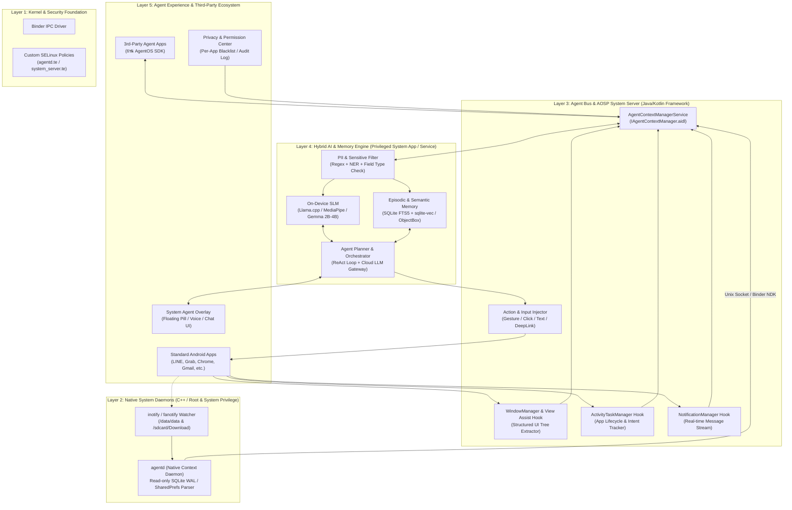
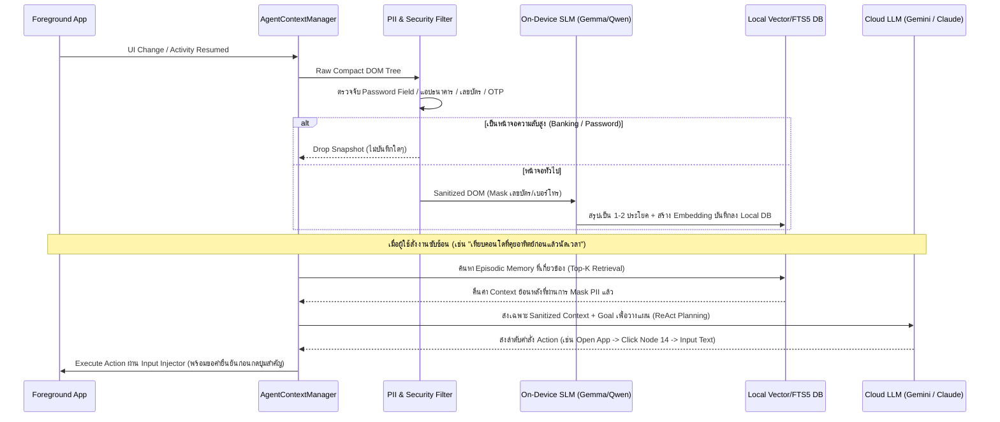

# 🏗️ 01 - Technical Architecture (สถาปัตยกรรมทางเทคนิคเชิงลึก)

เอกสารนี้อธิบายสถาปัตยกรรมระดับระบบของ **Agentic Mobile OS** ตั้งแต่ระดับ Linux Kernel / Native Daemon ไปจนถึง Android Framework (`system_server`) และชั้น AI Orchestration

---

## 1. แผนผังสถาปัตยกรรม 5 ชั้น (5-Layer System Architecture)



---

## 2. รายละเอียดส่วนประกอบหลักในระดับ AOSP Framework (Layer 3)

### 2.1 Context & Event Collector (`AgentContextManagerService`)
แทนที่จะกวาดข้อมูลทุกมิลลิวินาทีจนเครื่องร้อนและแบตหมด เราออกแบบเป็น **Event-Driven + Semantic Snapshot**:

1. **`ActivityTaskManagerService` (ATMS) Hook:**
   * ดักจับจุดเปลี่ยนผ่านของ `ActivityRecord` (`onActivityResumed`, `onActivityPaused`, `startActivityMayWait`)
   * เก็บข้อมูล: `packageName`, `activityName`, `intentExtras` (เฉพาะที่ไม่ใช่ข้อมูลลับ), เวลาที่เข้าใช้งาน และระยะเวลาที่โฟกัส (Dwell Time)
2. **`WindowManagerService` (WMS) & `AssistStructure` Hook:**
   * ใช้กลไกเดียวกับ `AssistStructure` (ที่ใช้ใน `onProvideAssistData`) ผสมกับ `AccessibilityNodeInfo` เพื่อแปลงหน้าจอปัจจุบันให้เป็น **Compact Semantic DOM Tree**
   * **การบีบอัด (DOM Pruning):** ตัด `FrameLayout`/`ViewGroup` ที่ไม่มีความหมายและไม่มีข้อความออก เหลือเฉพาะโหนดที่มี Text, ContentDescription, หรือสถานะ `clickable/editable/scrollable`
   * ช่วยลดขนาด Context ของ 1 หน้าจอจาก ~150 KB (XML เต็ม) เหลือเพียง **1.5 – 4 KB (Compact JSON/Markdown)**
3. **`NotificationManagerService` Hook:**
   * ดักจับ `StatusBarNotification` ทันทีที่มีการแจ้งเตือนเข้า (เช่น ข้อความแชท, อีเมล, สถานะเดลิเวอรี) พร้อมแยกแยะ `RemoteInput` เพื่อให้ Agent สามารถกดตอบกลับ (Inline Reply) ในพื้นหลังได้โดยไม่ต้องเปิดแอปจริงขึ้นมากวนผู้ใช้

### 2.2 ตัวอย่างโครงสร้าง Compact Semantic DOM (JSON Schema)
ข้อมูลที่แปลงจากหน้าจอเพื่อส่งเข้า Memory และ LLM จะมีรูปแบบมาตรฐานดังนี้:

```json
{
  "snapshot_id": "snap_20261029_153012_01",
  "timestamp": 1793262612000,
  "foreground_app": "jp.naver.line.android",
  "activity": ".activity.chathistory.ChatHistoryActivity",
  "screen_summary_hint": "Chat conversation with Somchai (Agent Condo)",
  "nodes": [
    {"id": 10, "role": "header", "text": "สมชาย (นายหน้าคอนโด)", "bounds": [120, 88, 680, 152]},
    {"id": 14, "role": "message_in", "text": "ห้อง Noble อนุสาวรีย์ ชั้น 18ปล่อยเช่า 16,500 บาท/เดือน ครับ", "time": "15:28"},
    {"id": 15, "role": "message_in", "text": "นัดดูห้องได้วันเสาร์นี้ บ่าย 2 โมงครับ", "time": "15:29"},
    {"id": 22, "role": "input", "hint": "ข้อความ", "editable": true, "bounds": [140, 2180, 860, 2290]},
    {"id": 23, "role": "button", "desc": "ส่ง", "clickable": true, "bounds": [880, 2180, 1020, 2290]}
  ]
}
```

---

## 3. Data & Storage Proxy: Native C++ Daemon (`agentd`) (Layer 2)

จุดที่ยากแต่สร้างความแตกต่างจากแอป AI ทั่วไปได้มากที่สุด คือการอ่านข้อมูลระดับไฟล์และฐานข้อมูลใน `/data/data/<package_name>/` อย่างปลอดภัย:

### หลักการทำงานของ `agentd`:
* รันเป็น Native C++ Daemon ตั้งแต่ตอนบูตผ่าน `init.rc` (`/system/bin/agentd`)
* **Strict Read-Only Policy:** `agentd` ต้องเปิดไฟล์ SQLite ของแอปอื่นด้วยโหมด `SQLITE_OPEN_READONLY | SQLITE_OPEN_URI` (`immutable=1` หรืออ่านผ่าน Snapshot) **ห้ามเขียนหรือล็อกฐานข้อมูลของแอปหลักเด็ดขาด** เพื่อป้องกันไม่ให้แอปหลักเกิด `SQLiteDatabaseLockedException` จนแครช
* **File System Monitoring (`fanotify` / `inotify`):**
  * เฝ้าดูเฉพาะไฟล์ที่ลงท้ายด้วย `.db-wal` (Write-Ahead Log) ของแอปที่ผู้ใช้กดอนุญาต (Opt-in Whitelist)
  * เมื่อมีการเปลี่ยนแปลง และหน้าจอไม่ได้มีการใช้งานหนัก (Idle/Debounce 5 วินาที) จึงดึงเฉพาะแถวที่เพิ่มใหม่มาส่งเข้า Local Index

---

## 4. Agent Bus & AIDL Interface (`IAgentContextManager`)

เพื่อให้ System UI หรือ 3rd-party Agent คุยกับ OS ได้อย่างเป็นมาตรฐาน เราจะนิยาม Binder IPC ด้วย AIDL:

```aidl
// frameworks/base/core/java/android/app/agent/IAgentContextManager.aidl
package android.app.agent;

import android.app.agent.AgentContextSnapshot;
import android.app.agent.AgentActionRequest;
import android.app.agent.IAgentEventListener;

interface IAgentContextManager {
    /** ดึงโครงสร้างหน้าจอปัจจุบันแบบ Compact DOM */
    AgentContextSnapshot getCurrentScreenSnapshot(int flags);

    /** ค้นหาความจำย้อนหลังด้วย Semantic + Keyword Query */
    List<AgentContextSnapshot> queryEpisodicMemory(String query, long startTimeMs, long endTimeMs, int limit);

    /** ลงทะเบียนรับ Event แบบเรียลไทม์ (App Switch, Notification, UI State Change) */
    void registerEventListener(IAgentEventListener listener, in String[] packageFilter);
    void unregisterEventListener(IAgentEventListener listener);

    /** สั่งให้ OS ทำการกด พิมพ์ เลื่อน หรือเปิด DeepLink แทนผู้ใช้ */
    boolean executeAction(in AgentActionRequest action);

    /** ตั้งค่าการบล็อกแอปที่ไม่ต้องการให้ AI เข้าถึง */
    void setPackagePrivacyPolicy(String packageName, int policyMode);
}
```

---

## 5. ระบบความจำ 3 ระดับ (3-Tier Memory Architecture)

เพื่อให้ AI "จำบริบททั้งหมดของผู้ใช้ได้" โดยไม่เปลืองพื้นที่และค้นหาได้ในระดับมิลลิวินาที:

| ระดับความจำ | เทคโนโลยีที่ใช้ | หน้าที่และการจัดเก็บ | อายุข้อมูล (Retention) |
| :--- | :--- | :--- | :--- |
| **1. Working Memory (RAM Buffer)** | Ring Buffer ใน `AgentContextManagerService` | เก็บสถานะ 10 หน้าจอล่าสุด + ลำดับการสลับแอปใน Session ปัจจุบัน | ล้างเมื่อล็อกหน้าจอเกิน 30 นาที |
| **2. Episodic Memory (Local Disk)** | **SQLite FTS5** + **sqlite-vec** (Vector Embedding ขนาด 384/768 มิติ) | เก็บสรุปเหตุการณ์รายวันว่าเวลาไหนเปิดแอปอะไร คุยเรื่องอะไร เห็นข้อมูลอะไรบ้าง | 30 – 90 วัน (ตั้งค่าได้) |
| **3. Semantic / Entity Graph (Long-term)** | Relational Graph บน SQLite | เก็บข้อเท็จจริงถาวรเกี่ยวกับผู้ใช้ เช่น รายชื่อคนสำคัญ, สถานที่ทำงาน, ความชอบ, โปรเจกต์ที่กำลังทำ | ถาวร (ผู้ใช้ดูและลบเองได้) |

---

## 6. Hybrid AI Gateway (On-Device SLM + Cloud LLM)



### เหตุผลที่ต้องใช้สถาปัตยกรรม Hybrid:
1. **การสรุปหน้าจอ (Continuous Indexing)** เกิดขึ้นวันละหลายร้อยครั้ง หากส่งขึ้น Cloud ทุกครั้ง ค่า API จะแพงมากและกินแบตเตอรี่ จึงต้องใช้ **On-Device SLM (เช่น Gemma 3 1B/4B หรือ Qwen-2.5 1.5B ผ่าน `llama.cpp` / MediaPipe)** ร่วมกับ Embedding Model ขนาดเล็ก (`all-MiniLM` หรือ `Gecko-embedding` บน NPU/GPU)
2. **การวางแผนหลายขั้นตอน (Complex Multi-step Reasoning)** จะถูกเรียกใช้เฉพาะตอนที่ผู้ใช้กดสั่งงาน Agent เท่านั้น จึงสามารถเรียก Cloud LLM ประสิทธิภาพสูง (หรือให้ผู้ใช้ใส่ API Key ของตัวเอง / BYOK ในช่วง Open-Source) ได้อย่างคุ้มค่า

