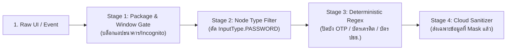

# 🛡️ 04 - Security, Privacy, App Compatibility & Battery Strategy

เอกสารนี้วางแนวทางการแก้ปัญหาที่ท้าทายที่สุด 3 ด้านของ **Agentic Mobile OS** ได้แก่:
1. **ความปลอดภัยและข้อมูลส่วนบุคคล (Security & Privacy)** – ทำอย่างไรให้ผู้ใช้กล้าใช้ OS ที่ AI มองเห็นหน้าจอ?
2. **ความเข้ากันได้ของแอป (App Compatibility & Play Integrity)** – ทำอย่างไรให้รันแอปทั่วไปและแอปการเงินได้?
3. **การจัดการพลังงานและประสิทธิภาพ (Battery & Thermal Optimization)** – ทำอย่างไรไม่ให้แบตหมดภายในครึ่งวัน?

---

## 1. สถาปัตยกรรมด้านความปลอดภัยและความเป็นส่วนตัว (Privacy-by-Design)

> **กฎเหล็ก 3 ข้อของ Agentic Mobile OS:**
> 1. **Local-First by Default:** ความจำทั้งหมดถูกเข้ารหัสและเก็บไว้ในเครื่องของผู้ใช้เท่านั้น ไม่มีการอัปโหลดประวัติการใช้งานขึ้น Cloud อัตโนมัติ
> 2. **Zero-Capture on Sensitive Contexts:** ระบบต้อง "หลับตา" อัตโนมัติเมื่อเปิดแอปการเงิน รหัสผ่าน หรือโหมดไม่ระบุตัวตน
> 3. **Human-in-the-Loop for High-Risk Actions:** AI ห้ามกดปุ่มโอนเงิน ลบข้อมูล หรือส่งข้อความสำคัญโดยไม่ผ่านการกดยืนยัน (Biometric / Confirm Tap) จากผู้ใช้

### 1.1 ระบบคัดกรองข้อมูลความลับ 4 ชั้น (4-Stage Sensitive Data Redaction Pipeline)

| ด่านคัดกรอง | วิธีการทำงานระดับเทคนิค | ตัวอย่างสิ่งที่ถูกบล็อก/ปิดบัง |
| :--- | :--- | :--- |
| **Stage 1: Package & Window Gate** | ตรวจสอบ `packageName` กับฐานข้อมูลหมวดหมู่แอปการเงิน/สุขภาพ และตรวจแฟล็ก `Private/Incognito` ของเบราว์เซอร์ | แอปธนาคารทุกค่าย (K PLUS, SCB, ฯลฯ), แอปจัดการรหัสผ่าน (Bitwarden, 1Password), แท็บไม่ระบุตัวตนใน Chrome |
| **Stage 2: Field-Level Filter** | ตรวจค่า `InputType` ของแต่ละ View Node (`TYPE_TEXT_VARIATION_PASSWORD`, `TYPE_NUMBER_VARIATION_PASSWORD`) | ช่องกรอกรหัสผ่าน, ช่องกรอก PIN 6 หลัก จะถูกแปลงเป็น `[REDACTED_SECRET]` ทันทีใน RAM |
| **Stage 3: Fast Regex & Checksum** | ใช้ Luhn Algorithm ตรวจเลขบัตรเครดิต 16 หลัก, Алกอริทึมเลขบัตรประชาชนไทย 13 หลัก, และแพทเทิร์นรหัส OTP | `"รหัส OTP ของคุณคือ 482910"` -> `"รหัส OTP ของคุณคือ [OTP_HIDDEN]"` |
| **Stage 4: Action Guardrail** | ก่อนที่ `ActionExecutor` จะคลิกปุ่มที่มีคำสำคัญเสี่ยง (เช่น *"โอนเงิน"*, *"ยืนยันคำสั่งซื้อ"*, *"ลบถาวร"*, *"ส่ง"*) | เด้งหน้าต่างระดับ System UI เพื่อให้ผู้ใช้สแกนนิ้วหรือกดปุ่ม **"อนุญาตให้ AI กดปุ่มนี้"** |

### 1.2 แผงควบคุมสิทธิ์แบบละเอียด (Agent Privacy Dashboard)
สร้างหน้าตั้งค่าใน `Settings -> Agent Privacy & Memory`:
* **ปุ่ม Kill Switch (Pause Agent Globally):** ปุ่มด่วนบน Quick Settings Tile สำหรับสั่งหยุดการรับรู้ของ AI ทันที (เช่น ปิดไมค์/ปิดการอ่านหน้าจอชั่วคราว 1 ชั่วโมง)
* **Per-App Permission Matrix:** กำหนดสิทธิ์รายแอปได้ 4 ระดับ:
  1. `Full Co-pilot` (อ่านบริบท + สั่งงานอัตโนมัติได้)
  2. `Read-Only Memory` (อ่านเพื่อช่วยจำได้ แต่ห้ามกดปุ่มแทน)
  3. `On-Demand Only` (AI จะมองเห็นเฉพาะตอนที่ผู้ใช้กดปุ่มเรียกใช้เท่านั้น ไม่เก็บประวัติเบื้องหลัง)
  4. `Strictly Blocked` (AI มองไม่เห็นและห้ามแตะต้องเด็ดขาด)
* **Transparent Audit Log:** แสดงประวัติชัดเจนว่า วันนี้ AI อ่านข้อมูลจากแอปไหนไปบ้าง และส่ง Prompt อะไรออกไปที่ Cloud LLM บ้าง (ผู้ใช้กดลบความจำรายวันหรือรายแอปได้ทันที)

---

## 2. การแก้ปัญหา App Compatibility & Google Play Integrity

เมื่อทำการปรับแต่ง AOSP หรือปลดล็อก Bootloader จะเกิดปัญหาหลัก 2 เรื่อง คือ **การขาด Google Mobile Services (GMS)** และ **การตรวจ Play Integrity API**

### แนวทางการรับมืออย่างเป็นระบบ:

1. **การรองรับ Google Play Services (GMS):**
   * ในรอมรุ่นนักพัฒนาและผู้ใช้ทั่วไป ให้ผสานรวม **microG (`GmsCore`)** พร้อมตั้งค่า Signature Spoofing เฉพาะสำหรับแพ็กเกจ `com.google.android.gms` ในระดับ Framework
   * ทำให้แอปที่ต้องใช้ Google Maps API, Firebase Cloud Messaging (Push Notification), และ Google Sign-In ทำงานได้ตามปกติโดยกินแรมน้อยกว่า GMS แท้ถึง 60%
   * รองรับการติดตั้ง **MindTheGapps / NikGapps** เป็นทางเลือกสำหรับผู้ใช้ที่ต้องการ Google Play Store เต็มรูปแบบ
2. **แนวทางสำหรับแอปธนาคาร (Banking Apps Strategy):**
   * *ความจริงที่ต้องสื่อสารตรงไปตรงมา:* แอปธนาคารในไทยเข้มงวดเรื่องการปลดล็อก Bootloader และการเปิด Accessibility Service มาก
   * **วิธีแก้ใน Phase 1 (User-space PoC):** ทดสอบบนเครื่องสำรอง หรือใช้ฟีเจอร์ซ่อนสถานะ Accessibility เฉพาะแอปที่ไม่ใช่เป้าหมาย
   * **วิธีแก้ใน Phase 2 (Custom AOSP):**
     * เนื่องจากเราดึง UI Tree ผ่าน `WindowManagerService` / `AgentContextManagerService` ภายในระดับ OS โดยตรง **เราจึงไม่จำเป็นต้องเปิด `AccessibilityService` ค้างไว้ในระบบ!**
     * ทำให้แอปที่ตรวจจับว่า *"กรุณาปิดการช่วยเหลือพิเศษ (Accessibility) ก่อนใช้งาน"* ไม่แจ้งเตือนบล็อกอีกต่อไป
     * สำหรับการลงนามรอม (ROM Signing): ต้องเซ็ตระบบบิลด์ให้เปลี่ยนจาก `test-keys` เป็น **Private Release Keys (`release-keys`)** ของโปรเจกต์เราเอง และตั้งค่า Verified Boot (`avbroot`) ให้สามารถล็อก Bootloader กลับด้วย Custom Key บนอุปกรณ์ตระกูล Google Pixel ได้!

---

## 3. การจัดการแบตเตอรี่ ความร้อน และทรัพยากรเครื่อง (Battery & Thermal Budget)

หากออกแบบไม่ดี ระบบดักจับหน้าจอและรัน AI ในเครื่องจะทำให้เครื่องร้อนและแบตหมดเร็วมาก เราจึงต้องกำหนด **Resource Budget** ที่เข้มงวด:

### 3.1 กลไกประหยัดพลังงาน 4 รูปแบบ:
1. **Event-Driven & Adaptive Sampling:**
   * ห้ามใช้การดึงข้อมูลแบบวนลูปตามเวลา (Polling) เด็ดขาด
   * เมื่อผู้ใช้กำลังเลื่อนหน้าจอด้วยความเร็วสูง (`SCROLL_STATE_FLING`) ให้ **ระงับการดึง DOM ทันที** และรอดึงเพียงครั้งเดียวเมื่อหน้าจอหยุดนิ่งเกิน `1,200 ms`
2. **Content Hash Deduplication (SimHash):**
   * ก่อนส่งข้อความไปทำ Vector Embedding หรือสรุปด้วย SLM ให้คำนวณ Hash อย่างเร็วก่อน (ใช้เวลา < 0.2 ms) หากเนื้อหาบนหน้าจอซ้ำเดิมเกิน 85% ให้ข้ามการประมวลผล AI ทันที
3. **Deferred Background Indexing (รอทำตอนชาร์จหรือตอนพักหน้าจอ):**
   * ในขณะใช้งานจริง ให้บันทึกเฉพาะ **Compact DOM + FTS5 (ข้อความดิบ)** ซึ่งใช้ CPU น้อยมาก (< 1%)
   * ส่วนงานที่กินพลังประมวลผลสูง เช่น การรัน On-Device SLM เพื่อสรุปเหตุการณ์รายวัน หรือการทำ Deep Clustering ความจำ ให้รันผ่าน `JobScheduler` เฉพาะเมื่อ **หน้าจอดับและแบตเตอรี่มากกว่า 50%** หรือ **ขณะเสียบสายชาร์จ (`setRequiresCharging(true)`)**
4. **Thermal & Battery Saver Integration:**
   * เชื่อมต่อกับ `PowerManager.OnThermalStatusChangedListener` หากอุณหภูมิเครื่องสูงถึงระดับ `THERMAL_STATUS_MODERATE` หรือเปิดโหมดประหยัดพลังงาน ให้สลับไปใช้โหมดประหยัดทันที (หยุด On-Device SLM ชั่วคราว เหลือเฉพาะการเก็บ FTS5 พื้นฐาน)

